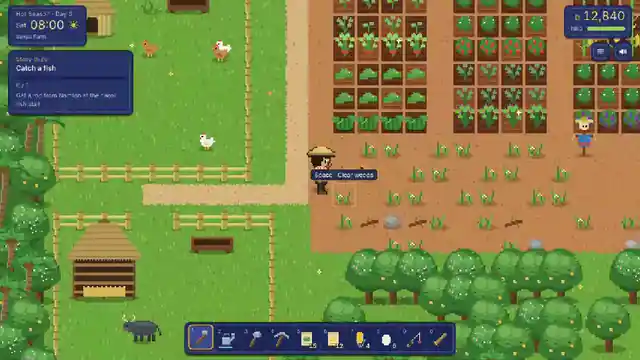

# | C5 |

**Lua / Luau scripter** · I also make games that run in the browser

Hi, I'm C5. I mostly script in Lua and Luau, and I make games you can play right in your browser.

### Projects

**[ไร่สุขใจ · Rai Sukjai](https://realceedc5.github.io/rai-sukjai/)**
A cozy Thai farming game in the browser, in the spirit of Stardew Valley.
Online co-op for up to 4, a beach and a mountain to explore, cutscenes, Thai / English.
[Play →](https://realceedc5.github.io/rai-sukjai/)

**[Portfolio](https://github.com/RealCeedC5/RealCeedC5.github.io)**
My site, in Thai and English.
[Visit →](https://realceedc5.github.io/)

 

### Languages

